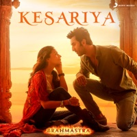

# 🪔 Patakha 3D — The Ultimate Virtual Diwali Experience 🎆

A high-fidelity, real-time 3D Diwali courtyard simulator built with **Three.js**, procedural **Web Audio API**, and **Tailwind CSS**. Celebrate an eco-friendly, pollution-free, noise-free yet thunderous Diwali right inside your browser!



---

## ✨ Features

### 💥 19 Iconic Indian Patakhas (Firecrackers)
1. **Sutli Bomb (सुतली बम)** — Classic green twine rassi bomb with heavy sub-bass blast.
2. **Lakshmi Bomb (लक्ष्मी बम)** — High-frequency crackle and sharp report.
3. **1000-Wala Lar (हज़ार वाली लड़ी)** — 24-cracker continuous chain cascade.
4. **Royal Anaar (रॉयल अनार)** — 5-second towering multi-color spark fountain.
5. **Zameen Chakri (ज़मीन चकरी)** — High-speed spinning neon ground chakri with whirring physics.
6. **Sky Shot Rocket (रॉकेट)** — Launch from bottle into the night sky with aerial burst.
7. **VIP Atom Bomb (वीआईपी एटम बम)** — 22-meter shockwave that triggers Sharma ji's car alarm!
8. **Phuljhadi (फुलझड़ी)** — Sparkling handheld wand with golden glitter.
9. **16-Shot Sky Cake (16-शॉट आतिशबाज़ी)** — Multi-shell aerial repeater.
10. **Kaala Saanp (काला साँप)** — Childhood nostalgia growing ash serpent.
11. **Mirchi Bomb (मिर्ची बम)** — Rapid-fire red explosive snap.
12. **Seeti Rocket (सीटी रॉकेट)** — Screaming siren whistle rocket.
13. **Disco Helicopter (डिस्को हेलीकॉप्टर)** — Spinning LED rotor that ascends skyward.
14. **Rang Birangi Smoke Bomb (रंग बिरंगा धुआँ)** — Thick cinematic colored smoke clouds.
15. **Lassan Pop-Pop (लहसुन पटाखा)** — Instant pressure-sensitive floor snapper.
16. **Parachute Rocket (पैराशूट रॉकेट)** — High-altitude flare drop with cloth canopy physics.
17. **Bullet Bomb (बुलेट बम)** — Heavy metal casing concussive blast.
18. **Gobar Blast (गोबर पर बम)** — 💩 Authentic desi prank! Flying manure chunks & screen mud splatter!
19. **10,000-Wala Mahabali Lar (१०,००० महाबली लड़ी)** — 🏮 60-cracker cascade with giant Mahabali Triangle finale explosion!

---

### 🪣 Desi Sandbox Physics & Destructible Props
* **Dabba Udao Trick (🪣)** — Place a 15-liter vegetable oil tin dabba directly over a Sutli bomb and watch it shoot into orbit!
* **Desi Can Pyramid (🥫)** — Stack 10 tin cans in a pyramid and blast them with shockwaves.
* **Shattering Matkas (🏺)** — Clay pots with realistic fracture mechanics, shard scattering, and clay thud sounds.
* **Akash Diya / Sky Lantern (🏮)** — Light floating paper lanterns that rise peacefully into the midnight sky.

---

### 📻 Bollywood Diwali Party Jukebox (13 Tracks)
Integrated with high-definition album art, vinyl rotation, scrubbing, and background audio:
1. *Kesariya* — Brahmāstra
2. *Lover* — Diljit Dosanjh
3. *What Jhumka ?* — Rocky Aur Rani Kii Prem Kahaani
4. *Kala Chashma* — Baar Baar Dekho
5. *Tum Tak* — Raanjhanaa
6. *London Thumakda* — Queen
7. *Chogada* — Loveyatri
8. *Dilliwaali Girlfriend* — Yeh Jawaani Hai Deewani
9. *Sauda Khara Khara* — Good Newwz
10. *Gallan Goodiyaan* — Dil Dhadakne Do
11. *Ghungroo* — War
12. *Badri Ki Dulhania* — BKD
13. *High Heels Te Nachche* — Ki & Ka

---

### 📲 Viral WhatsApp Unlock Ladder & Anti-Cheat Engine
* **Verified WhatsApp Sharing**: Automatically checks that players genuinely switch to WhatsApp and spend time picking a recipient before approving shares.
* **Recurring Viral Reminders**: Friendly festive reminders every 1:30 minutes to wish friends and family.
* **4-Tier Unlock Progression**:
  * 🎆 **16-Shot Sky Cake**: 2 WhatsApp Shares
  * ☢️ **VIP Atom Bomb**: 2 WhatsApp Shares
  * 💩 **Gobar Blast**: 3 WhatsApp Shares
  * 🏮 **10,000-Wala Lar**: 1 WhatsApp Share or 20 Blasts in Arena

---

## 🛠️ Tech Stack
* **3D Graphics**: [Three.js](https://threejs.org/) (r128) WebGL Renderer with custom lighting, shadows, and particle systems.
* **Audio Synthesis**: Web Audio API (procedural synthesis for explosions, fuses, whistles, and squelches).
* **Styling**: [Tailwind CSS](https://tailwindcss.com/) & custom glassmorphism HUD design.
* **Platform**: Pure Vanilla HTML5 & ES6+ JavaScript — runs on any modern mobile or desktop browser with 60 FPS performance!

---

## 🚀 Getting Started

1. Clone the repository:
   ```bash
   git clone https://github.com/jayadeepmk21/happy-diwali.git
   cd happy-diwali
   ```

2. Start a local server:
   ```bash
   # Python 3
   python -m http.server 8000
   ```

3. Open in your browser:
   ```
   http://localhost:8000/
   ```

---

## 📜 License
Distributed under the MIT License. See `LICENSE` for more information.

**Wishing you and your family a very Happy, Safe & Prosperous Diwali! 🪔✨**
